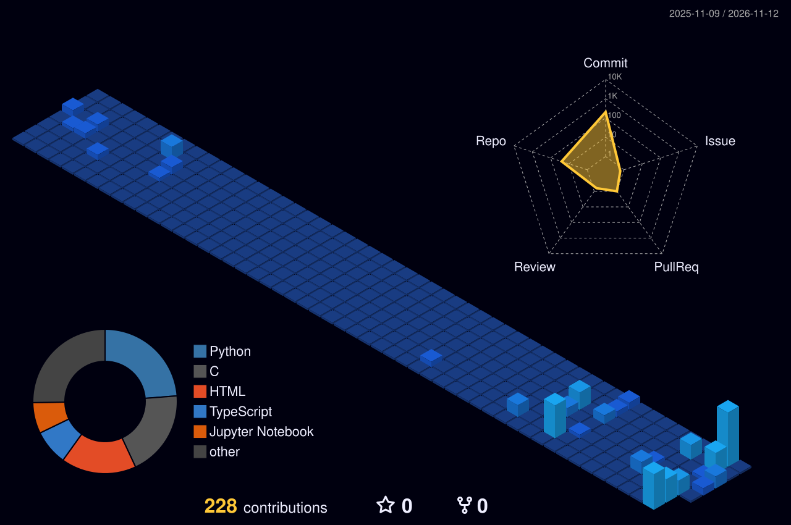

<!-- 🍥 ANIMATED NARUTO HERO -->

  

 

<!-- 🍥 MY NINJA WAY -->

  

<!-- 🔦 JUTSU ARSENAL -->

  

<!-- 🪪 NINJA REGISTRATION + MISSION DASHBOARD -->

  

## 🍥 S-Rank Missions

| Mission | What it is | Jutsu used |
|:--|:--|:--|
| [**RecoverAI**](https://github.com/bhuvanteja-0722/recoverai) | AI revenue-recovery hackathon project | See repository |
| [**Outbreak Agent Demo**](https://github.com/bhuvanteja-0722/outbreak-agent-demo) | Agent-based public-health early-warning exploration | See repository |
| [**SevaTrack**](https://github.com/bhuvanteja-0722/SevaTrack) | Civic-tech prototype for navigating public-service applications | See repository |
| [**NovaOS**](https://github.com/bhuvanteja-0722/NovaOS) | Operating-systems and low-level systems project | See repository |
| [**Smart Scheduler**](https://github.com/bhuvanteja-0722/smart-scheduler) | Scheduling application prototype | See repository |
| [**My Portfolio**](https://github.com/bhuvanteja-0722/my-portfolio) | Personal portfolio website | See repository |

<a href="https://github.com/bhuvanteja-0722?tab=repositories"><b>→ Explore all my repositories</b></a>

  

### 🌃 My contribution village

*Every commit builds another part of the village — generated automatically.*

  

  

<!-- 💌 JOIN THE SQUAD -->

  

 

**Believe it — keep coding, keep growing.** 🍥

