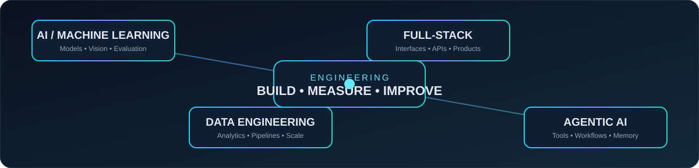
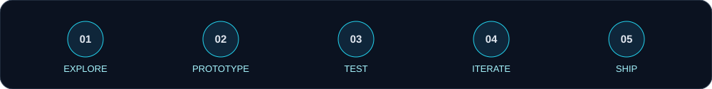

<!-- BHUVAN TEJA PONAKALA | Animated AI & Data Science Profile -->

  

  

---

### BUILD SYSTEMS. EXPLORE INTELLIGENCE. SHIP WITH PURPOSE.

I’m **Bhuvan Teja Ponakala**, an Artificial Intelligence & Data Science undergraduate at **BMS College of Engineering, Bengaluru**. I enjoy working across machine learning, data-centric applications, full-stack engineering, and emerging agentic systems.

I learn by building: exploring a problem, designing a working prototype, testing assumptions, and documenting what actually works.

## ◈ The engineer behind the commits

| Focus | What I'm exploring |
|:--|:--|
| **AI & Machine Learning** | Model experimentation, computer vision, prediction, evaluation |
| **Data Engineering & Analytics** | Data processing, analytics workflows, big-data concepts and pipelines |
| **Full-Stack Development** | Responsive applications, interfaces, and API-driven prototypes |
| **Agentic AI** | Multi-step workflows, agent responsibilities, tool boundaries, memory and observability |
| **Systems & Emerging Tech** | Operating-system fundamentals, blockchain concepts and developer tooling |

## ◈ Selected builds

A project gallery, not a repository dump. Descriptions reflect the documented scope; prototype and simulated behavior is called out clearly.

<table>
<tr>
<td width="50%" valign="top">

### ◉ RecoverAI
**AI revenue recovery command center**

A hackathon demo for identifying revenue at risk, prioritising recovery actions, presenting AI-style diagnosis, and maintaining an inspectable audit trail.

`React` `TypeScript` `Workflow UX`

<a href="https://github.com/bhuvanteja-0722/recoverai">Explore repository ↗</a>
</td>
<td width="50%" valign="top">

### ◉ FlowPilot
**AI cash-flow copilot**

A PayPal-oriented prototype that summarises payment activity, surfaces transaction risks, and guides review-first actions. Demo mode does not send live payment requests.

`React` `TypeScript` `Express` `tRPC`

<a href="https://github.com/bhuvanteja-0722/FlowPilot">Explore repository ↗</a>
</td>
</tr>
<tr>
<td width="50%" valign="top">

### ◉ Outbreak Agent Demo
**Multi-agent public-health early-warning prototype**

A notebook-based exploration of parallel signal collection, symptom extraction, anomaly detection, short-term forecasting, and alert generation using synthetic signals.

`Python` `Pandas` `scikit-learn` `Forecasting`

<a href="https://github.com/bhuvanteja-0722/outbreak-agent-demo">Explore repository ↗</a>
</td>
<td width="50%" valign="top">

### ◉ SevaTrack
**Citizen-side public-service workflow guide**

A civic-tech prototype translating synthetic application statuses into plain-language explanations, next steps, and escalation guidance. It does not connect to live government systems.

`React` `TypeScript` `Vite` `Tailwind CSS`

<a href="https://github.com/bhuvanteja-0722/SevaTrack">Explore repository ↗</a>
</td>
</tr>
<tr>
<td width="50%" valign="top">

### ◉ NovaOS
**Local-first operating-system project**

An incremental x86-64 OS project focused on a reproducible bootable kernel, QEMU testing, and a documented path toward memory, process, filesystem, and security subsystems.

`C` `Assembly` `QEMU` `Systems`

<a href="https://github.com/bhuvanteja-0722/NovaOS">Explore repository ↗</a>
</td>
<td width="50%" valign="top">

### ◉ Indian Cricketer Face Identification
**Computer-vision recognition project**

A face-identification workflow using a fine-tuned EfficientNet-B0 backbone, MTCNN face detection, and a Streamlit interface.

`Python` `PyTorch` `EfficientNet` `Streamlit`

<a href="https://github.com/bhuvanteja-0722/Indian-Cricketer-Face-Recognition-Project">Explore repository ↗</a>
</td>
</tr>
<tr>
<td width="50%" valign="top">

### ◉ Steer Lab
**Research-to-social-content workflow prototype**

A front-end workflow with simulated pipeline stages, content previews, claim-level review, and JSON/CSV export. It does not fetch papers or verify claims automatically.

`React` `Vite` `TypeScript` `CSV/JSON`

<a href="https://github.com/bhuvanteja-0722/steerlab-github-ready">Explore repository ↗</a>
</td>
<td width="50%" valign="top">

### ◉ Smart Scheduler
**Scheduling application**

A scheduling-focused project in my repository portfolio. See the repository for its current implementation and setup details.

<a href="https://github.com/bhuvanteja-0722/smart-scheduler">Explore repository ↗</a>
</td>
</tr>
</table>

## ◈ Technologies I work with

**Programming & Web**

  

**Data, AI & Developer Tools**

  

These are technologies represented in my learning and project work, not a claim of equal proficiency in every tool. I’m continuously improving depth, fundamentals, and engineering practices.

## ◈ GitHub telemetry

  

  

## ◈ Beyond the editor

**Hackathons · Collaborative builds · Continuous learning**

I enjoy working with teams, exploring unfamiliar technologies, and turning rough ideas into demonstrable software.

## ◈ Let's build something useful

  
*Curiosity in. Experiments out. Better systems every iteration.*

